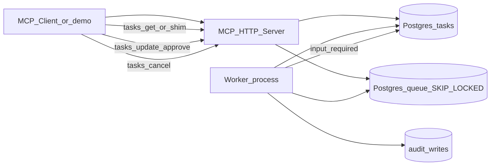

# Night-Shift Agent

A small, runnable reference implementation for the blog series **Grace and the Night-Shift Agent** - building MCP agents that keep running after the request ends.

One MCP task server accepts long-running jobs, returns a task handle immediately, and survives worker crashes, retries, human approval, and cancellation. Matching **Node.js (TypeScript)** and **Python** implementations share the same Postgres schema and behavior.

## Quickstart

```bash
docker compose up -d
```

Wait until Postgres is healthy (`docker compose ps`), then pick a language.

### Node.js

```bash
cd node
npm install
npm run migrate
npm run server          # terminal 1 - http://127.0.0.1:3100/mcp
npm run worker          # terminal 2 (optional; demos can drive the worker in-process)
npm run demo:day0       # terminal 3
npm test                # local tests (no CI)
```

### Python

```bash
cd python
# either:
uv sync --extra dev && uv run night-shift migrate
# or:
python -m pip install -e ".[dev]" && night-shift migrate

night-shift server          # terminal 1 - http://127.0.0.1:3200/mcp
night-shift worker          # terminal 2 (optional)
night-shift demo day0
pytest                      # local tests (no CI)
```

Run Node and Python test suites **one at a time** - they share the same local Postgres and truncate tables between cases.

## Architecture



- **`triage_tickets`** enqueues work and returns a task id immediately.
- A separate **worker** claims jobs with `FOR UPDATE SKIP LOCKED`, checkpoints every 50 tickets, and resumes after crashes.
- Side effects go through **`audit_writes`** with idempotency keys in the **same transaction**.
- High-severity tickets pause in **`input_required`** until approve/deny (with expiry).
- Cancellation is cooperative; TTL cleanup expires stale tasks.

Internal store status `queued` maps to wire status `working` with `statusMessage: "queued"`.

## MCP Tasks (SEP-2663) and SDK gaps

| Runtime | Surface |
|---|---|
| **Node** | HTTP JSON-RPC at `/mcp` with native-shaped methods `tasks/get`, `tasks/update`, `tasks/cancel`, plus tool `triage_tickets` returning `resultType: "task"`. Tool shims `get_task` / `update_task` / `cancel_task` are also listed for clients that only speak tools. |
| **Python** | The official `mcp` package does **not** implement SEP-2663 yet. This repo uses a **tool-based shim** (`get_task`, `update_task`, `cancel_task`) returning the same JSON shapes. The HTTP demo server also accepts `tasks/*` method names as a local alias - that is **not** official SDK support. |

When the Python SDK gains Tasks, prefer the native methods and keep the tool names as a compatibility layer.

## Demos

See [demos/README.md](demos/README.md) for day0 / day2–day5 scripts (fragile vs queued, crash/resume, idempotent retry, approval, cancel).

## Production checklist

See [checklist/NIGHT_SHIFT_CHECKLIST.md](checklist/NIGHT_SHIFT_CHECKLIST.md).

## Series posts

- Day 0 - *(placeholder)*
- Day 2 - *(placeholder)*
- Day 3 - *(placeholder)*
- Day 4 - *(placeholder)*
- Day 5 - *(placeholder)*

## License

[MIT](LICENSE)
